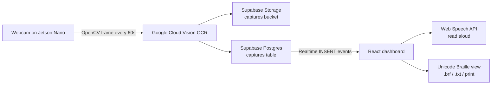

# Brixel

**An AI classroom assistant that turns what's written on the whiteboard into speech and Braille for visually impaired students.**


Built at **LionHacks 2026** (Hammond, Louisiana) in six hours by a team of three.

---

## Overview

In most classrooms, the key information lives on the whiteboard. Students who are blind or have low vision often depend on someone else to read it to them, and they rarely get a Braille copy in time to follow the lesson.

Brixel puts a camera in front of the whiteboard. A Jetson Nano captures the board on a timer, reads the text with OCR, and pushes each capture to a cloud database. A live web dashboard picks up new captures instantly, reads the text aloud through the browser (for example, to a student's AirPods), and lets the student or teacher export the content as Braille.

## Key features

- **Automatic whiteboard capture** - a Jetson Nano grabs a webcam frame with OpenCV on a fixed interval (every 60 seconds by default).
- **Text extraction** - each frame is sent to Google Cloud Vision for text detection.
- **Cloud sync** - the image is uploaded to Supabase Storage and the extracted text is saved to a `captures` table.
- **Live dashboard** - the React app subscribes to Supabase Realtime, so new captures appear without a page refresh.
- **Read aloud** - each new capture is spoken automatically as it arrives, and any capture can be replayed with one click. Speech uses the browser's Web Speech API, which plays through whatever audio device is connected (headphones, AirPods, speakers).
- **Braille view and export** - text is shown as Unicode Braille and can be downloaded as a `.brf` file, downloaded as plain text, or printed.
- **Session history** - a history page lists past captures, with filters (for example, captures flagged as assignments).

## How it works



1. `backend/pipeline.py` runs on the Jetson Nano in a loop: capture a frame, run OCR, upload the image, insert a row into `captures`.
2. The dashboard (`frontend/`) loads recent captures and listens for new rows through a Supabase Realtime channel.
3. When a capture is selected, the student can hear it read aloud or open it in the Braille panel to export or print.

## Tech stack

| Layer | Tools |
| --- | --- |
| Edge device | NVIDIA Jetson Nano, USB webcam, Python, OpenCV |
| OCR | Google Cloud Vision API (`text_detection`) |
| Backend / data | Supabase (Postgres, Storage, Realtime), FastAPI (optional upload endpoint) |
| Frontend | React 19, Vite, React Router, Tailwind CSS, `@supabase/supabase-js` |
| Accessibility | Web Speech API (text-to-speech), Unicode Braille, `.brf` export |

## Project structure

```
Brixel/
├── backend/          # Jetson Nano scripts: capture + OCR pipeline, FastAPI upload endpoint
├── frontend/         # React + Vite dashboard (live feed, history, Braille export)
└── supabase/
    └── schema.sql    # Tables: students, sessions, captures
```

## Getting started

### Prerequisites

- Python 3.8+ and a USB webcam (the pipeline was run on a Jetson Nano, but any machine with a camera works)
- Node.js 18+ and npm
- A Supabase project
- A Google Cloud project with the Vision API enabled and a service-account key

### 1. Set up Supabase

1. Run `supabase/schema.sql` in the Supabase SQL editor.
2. Create a public Storage bucket named `captures`.
3. Enable Realtime on the `captures` table so the dashboard receives live inserts.

### 2. Run the capture pipeline (edge device)

```bash
cd backend
python -m venv venv
source venv/bin/activate
pip install opencv-python google-cloud-vision supabase

export SUPABASE_URL=...                         # your Supabase project URL
export SUPABASE_KEY=...                         # your Supabase API key
export GOOGLE_APPLICATION_CREDENTIALS=/path/to/service-account.json

python pipeline.py
```

To test OCR on a single saved image instead, run `python ocr_jetson.py` (it reads `latest_capture.jpg`).

### 3. Run the dashboard

```bash
cd frontend
npm install
```

Create `frontend/.env`:

```
VITE_SUPABASE_URL=...
VITE_SUPABASE_ANON_KEY=...
```

Then start the dev server:

```bash
npm run dev
```

The dashboard has three pages: `/` (live dashboard), `/history`, and `/braille` (Braille export).

### Optional: FastAPI upload endpoint

`backend/backend.py` exposes `POST /upload` (image + text form fields) that saves the image locally and inserts a row into a Supabase table. Run it with:

```bash
pip install fastapi uvicorn python-multipart supabase
uvicorn backend:app --reload
```

## Current limitations

- The dashboard's Braille conversion is a simple letter-by-letter (uncontracted) mapping of a-z; numbers and punctuation are not yet translated, and the `.brf` file contains Unicode Braille rather than ASCII Braille.
- `backend/main.py` is an alternate pipeline that imports helper modules (`capture`, `text_extractor`, `braille_converter`, `tts_player`) that are not included in this repository.
- The schema has columns for `braille_unicode`, `braille_brf`, `audio_url`, and `subject_guess`, but the current pipeline only fills in the image URL and raw text.

## Future improvements

- Contracted (Grade 2) Braille translation with a library such as liblouis, and true ASCII `.brf` output for embossers.
- Fill in subject detection and assignment flagging during the pipeline so the dashboard filters are populated automatically.
- Tighten the open row-level security policies in Supabase.

## Team

Built at LionHacks 2026 by:

- **Riyaj Chaulagain** - Jetson Nano capture and OCR pipeline, Supabase integration ([GitHub](https://github.com/riyajclgn123) · [Portfolio](https://riyajchaulagain.com.np))
- **Sagar Bastola** - Braille panel, print export, session log
- **Skrit** - dashboard UI, live feed, text-to-speech, Braille conversion
